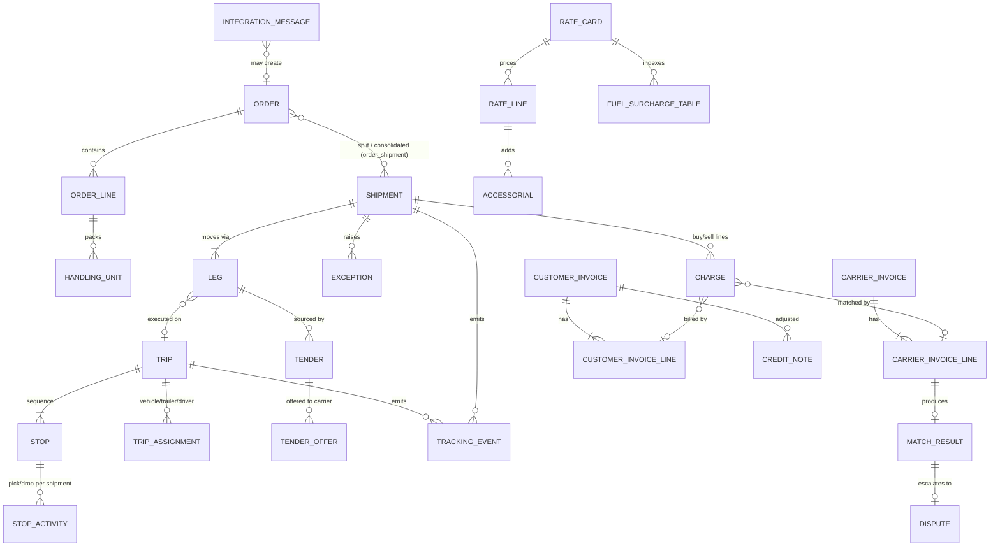

# HP TMS — Phase 0 Plan (Foundation)

Status: **DRAFT, awaiting approval.** No code is written until this plan and the open questions in §11 are answered.
Source of truth for scope: [`docs/BRIEF.md`](./BRIEF.md).

**Phase 0 is done when** a tenant admin can log in, create users and roles, and load customers, locations, carriers and vehicles. Underneath that, the plan puts in place everything later phases rely on: tenancy, RLS, RBAC, audit, the outbox, i18n/RTL, CI and the module skeleton.

---

## 1. Stack decisions (and the changes from the brief)

| Layer | Choice | Why |
| --- | --- | --- |
| Monorepo | **pnpm workspaces + Turborepo** | One repo for web, mobile, backend and shared contracts; cached builds in CI. |
| Backend | **NestJS (TypeScript)** modular monolith | One language across backend, web and React Native, so DTOs, validation schemas, permission keys and event types are shared rather than duplicated. Nest modules map cleanly to the module boundaries in the brief. |
| ORM / migrations | **Drizzle ORM** for queries, **plain SQL migrations** (versioned, reviewed) | RLS policies, partitioning, PostGIS types and grants have to be written as SQL anyway. Prisma handles per-transaction `SET LOCAL` (needed for RLS) poorly; Drizzle runs it inside a transaction without trouble. |
| Validation / contracts | **Zod** schemas in `packages/contracts` → OpenAPI 3.1 generated from them | One schema drives API validation, the web forms, the mobile app and the published spec. |
| Database | PostgreSQL 16 + PostGIS, RLS | As specified. |
| Events | **Transactional outbox → RabbitMQ** (topic exchange) | RabbitMQ is simpler to run than Kafka and handles the brief's volumes (50 GPS pings/s is low). If tracking ingestion or analytics replay ever needs a log, Kafka/Redpanda can be added for those streams alone. |
| Cache | Redis (permission cache, rate limits, OTP throttling, sessions denylist) | |
| Web | Next.js (App Router) + Tailwind (logical properties only) + **shadcn/ui on Radix** + TanStack Query + AG Grid | Radix primitives respect `dir="rtl"`, and AG Grid has `enableRtl`. |
| Mobile (Phase 1) | **React Native (Expo, bare workflow where needed) + WatermelonDB** | Same TypeScript contracts as the backend. WatermelonDB is built for offline sync. |
| i18n | **i18next / ICU MessageFormat**, JSON translation files per locale; `Intl` for numbers, dates and currency; `Intl` `islamic-umalqura` calendar for the Hijri option | The same library and file format on web and mobile. |
| Optimiser (Phase 3) | Python + OR-Tools service | As specified. Not touched in Phase 0. |
| Infra | Docker Compose for local; Terraform + Kubernetes (EKS or AKS, see Q1) | As specified. Phase 0 ships Compose plus a Terraform skeleton only. |

## 2. Repository structure

```
hp-tms/
├─ apps/
│  ├─ api/                    # NestJS modular monolith (HTTP + workers via role flag)
│  │  └─ src/
│  │     ├─ main.ts           # boots "api" or "worker" role
│  │     ├─ platform/         # cross-cutting kernel: db, tenancy context, audit, outbox, flags, i18n, errors
│  │     └─ modules/
│  │        ├─ identity/      # tenants, users, auth, SSO, RBAC  (Phase 0)
│  │        ├─ masterdata/    # parties, locations, fleet, drivers, commodities, reference (Phase 0)
│  │        ├─ orders/  planning/  rating/  carriers/  execution/
│  │        ├─ visibility/  documents/  finance/  integrations/
│  │        └─ notifications/  analytics/       # empty skeletons with module README + public interface
│  ├─ web/                    # Next.js office platform + super-admin console
│  ├─ portal/                 # Next.js customer + carrier portal (Phase 1/2; white-label host routing)
│  ├─ driver/                 # Expo driver app (Phase 1)
│  ├─ customer-mobile/        # Expo customer app (Phase 2+)
│  └─ optimizer/              # Python OR-Tools service (Phase 3)
├─ packages/
│  ├─ contracts/              # Zod schemas, DTOs, event types, permission keys → OpenAPI
│  ├─ ui/                     # design system (tokens, RTL-safe components, AG Grid wrapper)
│  ├─ i18n/                   # translation JSON (en, ar, hi, …) + formatting helpers
│  ├─ domain-kernel/          # Money, Quantity/UoM, TimeWindow, Result, IDs (pure TS, no IO)
│  ├─ country-packs/          # AE, SA, IN packs: tax schemes, ID formats, address formats, holidays
│  ├─ api-client/             # typed client generated from OpenAPI (used by web + mobile)
│  └─ config/                 # eslint, tsconfig, tailwind presets
├─ db/
│  ├─ migrations/             # NNNN_description.sql — the only way the schema changes
│  ├─ seed/                   # demo tenant seed (UAE LSP) + global reference data
│  └─ erd/                    # generated ER diagram (mermaid + SVG), checked in CI
├─ infra/
│  ├─ docker/                 # compose: postgres+postgis, redis, rabbitmq, minio, opensearch, mailpit
│  └─ terraform/              # per-region "cell" modules (skeleton in Phase 0)
├─ tests/
│  ├─ e2e/                    # Playwright
│  └─ load/                   # k6 (from Phase 1)
├─ docs/
│  ├─ BRIEF.md  PHASE-0-PLAN.md
│  ├─ adr/                    # architecture decision records (one per decision in §1)
│  └─ openapi/                # generated openapi.yaml (committed, diffed in CI)
└─ .github/workflows/         # ci.yml, security.yml, preview.yml
```

**Module rules, enforced in CI with `eslint-plugin-boundaries` / dependency-cruiser:**
- A module exports only `index.ts`: its public service interface, DTOs and event types. Importing another module's internals fails the build.
- Each module owns a Postgres schema (`identity`, `masterdata`, `orders`, …) and its own tables. No module reads another module's tables in code.
- Foreign keys may point *upstream* only: everything may reference `identity` and `masterdata`, and nothing references a downstream module. This keeps referential integrity without coupling the code.
- Controllers only parse, authorise and delegate. Business logic lives in domain services, which have unit tests.

## 3. Multi-tenancy and data residency

### 3.1 Deployment shape: regional cells
- Each region (e.g. UAE, India, EU, US) is a **cell**: a full stack with its own Postgres, Redis, RabbitMQ, object storage and OpenSearch. Tenant data never leaves its cell.
- A small **global directory** (its own tiny DB) holds only `tenant_slug → home_region`, verified email domains → tenant, and the custom domain → tenant mapping. It stores no personal data beyond what routing needs (see Q3).
- Login starts at `app.hptms.com`. The directory resolves the tenant (by slug, custom domain or email domain) and redirects to the regional host (e.g. `me.app.hptms.com`).
- Dedicated database for a large tenant: the cell's `tenant_datasource` table maps a tenant to a connection pool. The default is the shared pool. The same migrations and RLS run everywhere, so moving a tenant out is a data move, not a code change.

### 3.2 Row-level security (the hard boundary)
- Every tenant table has `tenant_id uuid NOT NULL`, `ENABLE` **and** `FORCE ROW LEVEL SECURITY`, plus one policy template:
  ```sql
  CREATE POLICY tenant_isolation ON masterdata.location
    USING      (tenant_id = current_setting('app.tenant_id')::uuid)
    WITH CHECK (tenant_id = current_setting('app.tenant_id')::uuid);
  ```
- The app connects as `tms_app`. That role does not own the tables, is not a superuser and does not have `BYPASSRLS`. Every request runs in a transaction that begins with `SET LOCAL app.tenant_id = $1, app.user_id = $2, app.request_id = $3`. If `app.tenant_id` is missing, `current_setting` raises an error, so the query fails closed.
- **Cross-tenant references are impossible by construction.** Every tenant table has `UNIQUE (tenant_id, id)`, and every foreign key is composite: `FOREIGN KEY (tenant_id, customer_id) REFERENCES … (tenant_id, id)`.
- Platform super-admin endpoints use a separate `tms_platform` role with narrowly granted `BYPASSRLS` on control-plane tables only. These endpoints live in a separate Nest module behind a separate guard, and every call is audited.
- A migration lint step fails CI if any new table with a `tenant_id` column has no RLS policy.

### 3.3 Intra-tenant data scoping (business unit, branch, customer, carrier)
- Enforced in the **repository layer**. Every query on a scoped aggregate goes through `ScopedRepository`, which adds the caller's scope predicate (taken from their role assignments, §5.3). Skipping it needs an explicit `.unscoped('reason')`, which is lint-flagged and audited.
- External users get a second guard: carrier and customer users carry `party_id` on their membership, and RLS policies on external-facing tables (shipments, tenders, invoices, from Phase 1) also check `app.party_id` when it is set. So a carrier user is isolated by the database, not only by code.

### 3.4 Proof of isolation (acceptance criterion)
An automated suite `tests/isolation/` seeds tenants A and B. For **every** tenant table, discovered from `information_schema`, so new tables are covered automatically, it asserts that as tenant A you:
- cannot SELECT B's rows,
- cannot UPDATE or DELETE B's rows,
- cannot INSERT with B's `tenant_id`, and
- cannot create a foreign key pointing at a B row.

The same checks run again at the API level: every list, get, update and delete endpoint is called with A's token and B's IDs and must return 404.

## 4. Authentication

| Who | Method |
| --- | --- |
| Office users | Email + password (argon2id) + **mandatory MFA for admins**, optional for others per tenant policy. TOTP first; WebAuthn/passkeys as a second factor type in the same `mfa_factor` table. |
| SSO tenants | Per-tenant `identity_provider` (OIDC via `openid-client`, SAML 2.0 via `@node-saml/node-saml`). The tenant is found by verified email domain. JIT provisioning with a default role is optional. Local passwords can be disabled per tenant. |
| Drivers | Phone (E.164) + SMS/WhatsApp OTP. The device is bound on first login (the device generates a key pair, and the public key is stored in `device`). A PIN unlocks the locally stored refresh token. |
| API clients (Phase 4) | OAuth 2.0 client credentials. The `api_client` table is created in Phase 0 so the model is complete. |

**Tokens and sessions**
- Access token: JWT signed ES256 with per-region keys from the vault, 10-minute lifetime. Claims: `sub` (user), `tid` (tenant), `mid` (membership), `typ` (staff, driver, carrier, customer), `pv` (permission version), `region`.
- Refresh token: opaque, stored hashed, **rotated on every use with reuse detection** (reuse revokes the whole family).
- Web: the Next.js server holds tokens in an `httpOnly; Secure; SameSite=Lax` cookie, and the browser never sees a JWT. Mobile: secure storage (Keychain/Keystore).
- Per-tenant policy: idle timeout, absolute session length, MFA requirement, password policy, **IP allow-list (CIDR list)** checked by auth middleware on every request, and allowed login methods.
- Brute-force protection: per-account and per-IP throttles in Redis; OTPs are 6 digits, 5 attempts, 5-minute TTL, with send rate limits per phone and per IP.
- Every auth event (login, failure, MFA enrol, password reset, token-reuse detection) goes to the audit log.

## 5. RBAC

### 5.1 Permission model
- A permission is `module.resource:action`, e.g. `masterdata.customer:create` or `finance.carrier_invoice:approve`.
- Standard actions: `view, create, edit, approve, delete, export`. Modules can add specific ones (e.g. `execution.trip:dispatch`).
- The permission catalogue is **code-defined** in `packages/contracts/permissions.ts` and synced into a `permission` table at deploy. The UI renders the role editor from it, and the backend guard and the frontend hide/disable logic use the same keys.
- Feature flags gate modules: if `orders` is off for a tenant, its permissions are hidden in the role editor and its endpoints return 404.

### 5.2 Roles
- **System role templates** (`tenant_id IS NULL`, read-only) for the 12 default roles in the brief.
- When a tenant is created, the templates are **copied** into tenant roles. Tenant admins can then edit, clone, create or deactivate roles. A cloned role keeps `cloned_from_id` for traceability.
- Guard rails: a tenant admin cannot grant a permission they do not hold, and the last role holding `identity.role:edit` cannot be removed (lock-out protection).

### 5.3 Assignments and scope
`role_assignment (membership_id, role_id, scope_type, scope_id)`:
- `scope_type ∈ {tenant, business_unit, branch}` for staff, e.g. "Planner for the Jebel Ali branch only".
- External users are additionally pinned by `membership.party_id` (their carrier or customer company).
- Customer-scoped staff (e.g. a key-account CS agent): `membership_scope (membership_id, scope_type='customer'|'carrier', party_id)` limits the rows they see.
- Effective permissions = the union over assignments, kept as a map from permission to the scopes it applies in. This is cached in Redis under `perm:{membership_id}:{pv}`. Any role or assignment change bumps `pv` (permission version) on the membership, which invalidates the cache immediately because the token's `pv` no longer matches.

### 5.4 Enforcement
- `@RequirePermission('masterdata.customer', 'create')` on controller handlers. A global guard **denies by default**: a handler with no decorator fails CI (a test walks all routes).
- The scope check happens in `ScopedRepository` (§3.3), not in controllers.

## 6. Audit log and domain events

**Audit**
- `platform.audit_log` is append-only. `tms_app` has `INSERT` and `SELECT` only; `UPDATE`, `DELETE` and `TRUNCATE` are revoked. It is partitioned monthly by `occurred_at`.
- Rows are written **in the same transaction** as the change, by a Drizzle write wrapper that diffs before and after: entity, entity ID, action, `changes: [{field, old, new}]`, actor, actor type, request ID, IP, user agent and reason (amendment reasons from Phase 1).
- Tamper evidence: each row stores `hash = sha256(prev_hash || row)` per tenant chain. A nightly job verifies the chain. Export to CSV/Excel for auditors is filtered by entity and date.
- Sensitive fields (bank account, passwords, MFA secrets) are redacted in diffs; the log records only "changed".

**Events**
- `platform.outbox_event` is written in the same transaction as the state change: `event_type` (e.g. `masterdata.customer.created`), version, aggregate, payload, `tenant_id`, `occurred_at`.
- A relay worker uses `SELECT … FOR UPDATE SKIP LOCKED` to publish to RabbitMQ topic exchange `tms.events` with routing key = event type, then marks rows published. Delivery is at-least-once, and consumers are idempotent through an `inbox` table (`consumer, event_id`).
- Event schemas are versioned Zod types in `packages/contracts/events`. Webhooks (Phase 4) consume the same stream.
- A CI test checks that every command handler either emits an event and writes audit, or is explicitly marked read-only.

## 7. Data model

### 7.1 Conventions
- PK `id uuid` (UUIDv7, time-ordered, which indexes well). Every tenant table has `tenant_id`, `created_at`, `created_by`, `updated_at`, `updated_by`, `deleted_at` (soft delete) and `version int` (optimistic locking, so a stale edit returns 409).
- Unique constraints are partial on `deleted_at IS NULL`, so a soft-deleted code can be reused.
- Money: `amount numeric(19,4)` + `currency char(3)`. Exchange rates: `numeric(19,10)`. Floats are never used for money; JS uses `decimal.js` inside the `Money` type in `domain-kernel`.
- Time: all `timestamptz` in UTC. Each location carries an IANA `timezone` used for display. Dates without a time (holidays, expiry dates) are `date`.
- Quantities: value + UoM code, normalised to base units (kg, m³, m) in companion columns for querying.
- Translatable labels (reason codes, document types, role names) are stored as `jsonb {"en": "...", "ar": "...", "hi": "..."}` and fall back to the tenant default locale.
- **Global reference tables** (country, currency, UoM, permission catalogue, country packs) have **no `tenant_id`**. This is a deliberate exception to "every table has tenant_id": they are read-only for tenants and maintained by the platform super-admin. Tenants override them through tenant tables (e.g. `tax_code`, `holiday_calendar`). **Assumption A3.**

### 7.2 Phase 0 entity diagram

```mermaid
erDiagram
    %% ---------- identity schema ----------
    TENANT ||--o{ BUSINESS_UNIT : has
    BUSINESS_UNIT ||--o{ BRANCH : has
    TENANT ||--o{ TENANT_MEMBERSHIP : has
    USER_ACCOUNT ||--o{ TENANT_MEMBERSHIP : "belongs via"
    USER_ACCOUNT ||--o{ MFA_FACTOR : enrols
    USER_ACCOUNT ||--o{ DEVICE : binds
    USER_ACCOUNT ||--o{ REFRESH_TOKEN : holds
    USER_ACCOUNT ||--o{ EXTERNAL_IDENTITY : "linked to"
    TENANT ||--o{ IDENTITY_PROVIDER : configures
    IDENTITY_PROVIDER ||--o{ EXTERNAL_IDENTITY : issues
    TENANT ||--o{ ROLE : defines
    ROLE ||--o{ ROLE_PERMISSION : grants
    PERMISSION ||--o{ ROLE_PERMISSION : "granted in"
    TENANT_MEMBERSHIP ||--o{ ROLE_ASSIGNMENT : has
    ROLE ||--o{ ROLE_ASSIGNMENT : "assigned as"
    TENANT_MEMBERSHIP ||--o{ MEMBERSHIP_SCOPE : "limited by"
    TENANT ||--o{ FEATURE_FLAG : toggles
    TENANT ||--o{ NUMBER_SEQUENCE : numbers
    TENANT ||--o{ API_CLIENT : issues

    %% ---------- masterdata schema ----------
    TENANT ||--o{ PARTY : owns
    PARTY ||--o{ PARTY_ROLE : "acts as"
    PARTY ||--o| CUSTOMER_PROFILE : "if customer"
    PARTY ||--o| CARRIER_PROFILE : "if carrier"
    PARTY ||--o{ TAX_REGISTRATION : registers
    PARTY ||--o{ CONTACT : has
    PARTY ||--o{ PARTY_LOCATION : uses
    LOCATION ||--o{ PARTY_LOCATION : "used by"
    BRANCH ||--o{ LOCATION : "home of"
    PARTY ||--o{ VEHICLE : "owns (carrier)"
    PARTY ||--o{ DRIVER : "employs (carrier)"
    EQUIPMENT_TYPE ||--o{ VEHICLE : classifies
    EQUIPMENT_TYPE ||--o{ TRAILER : classifies
    TENANT_MEMBERSHIP |o--o| DRIVER : "app login"
    TENANT_MEMBERSHIP }o--o| PARTY : "external user of"
    DOCUMENT_TYPE ||--o{ DOCUMENT : types
    DOCUMENT ||--o{ DOCUMENT_LINK : "attached to"
    FILE_OBJECT ||--|| DOCUMENT : stores
    TENANT ||--o{ COMMODITY : catalogues
    TENANT ||--o{ TAX_CODE : configures
    TENANT ||--o{ HOLIDAY_CALENDAR : configures
    HOLIDAY_CALENDAR ||--o{ HOLIDAY : contains
    TENANT ||--o{ REASON_CODE : configures
    TENANT ||--o{ PAYMENT_TERM : configures
    CURRENCY ||--o{ EXCHANGE_RATE : quoted
    COUNTRY ||--o| COUNTRY_PACK : "rules in"

    %% ---------- platform schema ----------
    TENANT ||--o{ AUDIT_LOG : records
    TENANT ||--o{ OUTBOX_EVENT : emits

    TENANT {
        uuid id PK
        text slug UK
        text name
        text home_region
        char2 country_code
        text default_locale
        char3 default_currency
        text default_timezone
        jsonb security_policy "mfa, session timeouts, ip_allowlist, login methods"
        jsonb branding "logo, colours, custom domain"
        text status
    }
    USER_ACCOUNT {
        uuid id PK
        citext email UK "nullable for phone-only drivers"
        text phone_e164 UK
        text password_hash "argon2id, nullable for SSO/OTP-only"
        text locale
        text status
        timestamptz last_login_at
    }
    TENANT_MEMBERSHIP {
        uuid id PK
        uuid tenant_id FK
        uuid user_id FK
        text user_type "staff|driver|carrier_user|customer_user"
        uuid party_id FK "carrier/customer company for externals"
        uuid default_branch_id FK
        int perm_version
        text status
    }
    ROLE {
        uuid id PK
        uuid tenant_id "NULL = system template"
        text code
        jsonb name_i18n
        uuid cloned_from_id
        bool is_system
    }
    PERMISSION {
        text key PK "module.resource:action"
        text module
        text action
    }
    ROLE_ASSIGNMENT {
        uuid membership_id FK
        uuid role_id FK
        text scope_type "tenant|business_unit|branch"
        uuid scope_id
    }
    PARTY {
        uuid id PK
        uuid tenant_id
        text code UK
        text legal_name
        text trade_name
        char2 country_code
        char3 default_currency
        text status
    }
    CUSTOMER_PROFILE {
        uuid party_id PK
        numeric credit_limit_amount
        char3 credit_limit_currency
        uuid payment_term_id FK
        text billing_cycle
        text invoice_locale
    }
    CARRIER_PROFILE {
        uuid party_id PK
        text trade_licence_no
        date trade_licence_expiry
        text_arr modes
        text_arr equipment_type_codes
        jsonb service_areas
        text approval_status
        text bank_account_ref "vault ref; masked display"
    }
    TAX_REGISTRATION {
        uuid party_id FK
        text scheme "AE_TRN|SA_VAT|IN_GSTIN|..."
        text number
        text state_code "IN place of supply"
        date valid_from
    }
    LOCATION {
        uuid id PK
        uuid tenant_id
        text code UK
        text name
        jsonb address "country-pack format"
        char2 country_code
        text makani_no
        text plus_code
        geography geo_point "PostGIS"
        int geofence_radius_m
        geography geofence_polygon
        text timezone
        jsonb operating_hours
        int dock_count
        jsonb constraints "max vehicle, tail-lift, appointment"
        text access_notes
    }
    VEHICLE {
        uuid id PK
        uuid tenant_id
        text registration_no
        char2 registration_country
        uuid owner_party_id "NULL = own fleet"
        text equipment_type_code FK
        numeric capacity_kg
        numeric capacity_m3
        int capacity_pallets
        int axle_count
        numeric max_gross_kg
        uuid home_branch_id FK
        text status
    }
    DRIVER {
        uuid id PK
        uuid tenant_id
        uuid membership_id FK
        uuid employer_party_id "NULL = own driver"
        text full_name
        text phone_e164
        text licence_no
        text licence_class
        date licence_expiry
        text status
    }
    DOCUMENT {
        uuid id PK
        uuid tenant_id
        text document_type_code FK
        uuid file_object_id FK
        text reference_no
        date issued_on
        date expires_on
        text status
        text ocr_text
    }
    AUDIT_LOG {
        uuid id PK
        uuid tenant_id
        text entity_type
        uuid entity_id
        text action
        jsonb changes "[{field, old, new}]"
        uuid actor_user_id
        text request_id
        inet ip
        timestamptz occurred_at
        bytea prev_hash
        bytea hash
    }
    OUTBOX_EVENT {
        uuid id PK
        uuid tenant_id
        text event_type
        int event_version
        text aggregate_type
        uuid aggregate_id
        jsonb payload
        timestamptz occurred_at
        timestamptz published_at
        int attempts
    }
```



Other Phase 0 tables, shown without attributes for readability: `business_unit`, `branch`, `mfa_factor`, `recovery_code`, `device`, `refresh_token`, `otp_challenge`, `identity_provider`, `external_identity`, `role_permission`, `membership_scope`, `feature_flag`, `number_sequence`, `api_client`, `party_role`, `contact`, `party_location`, `trailer`, `equipment_type`, `commodity` (HS code, UN number, ADR class, packing group, temperature range, stackability), `document_type` (applies-to, requires-expiry, alert days), `document_link` (polymorphic: entity type + ID), `file_object`, `tax_code`, `payment_term`, `holiday_calendar`, `holiday`, `reason_code`, `exchange_rate`, `idempotency_key`, `inbox`. Global tables: `country`, `currency`, `uom`, `uom_conversion`, `country_pack`, `permission`, `tenant_datasource`.

Design notes:
- **Party + roles** rather than separate customer and carrier tables. One legal entity can be both customer and subcontractor, which is common among GCC LSPs. Role-specific data lives in 1:1 profile tables.
- **Documents are generic** (`document` + `document_link`). Carrier trade licences, driver licences, visas, Emirates IDs and vehicle registrations all use one table with `expires_on`. A daily job emits `masterdata.document.expiring` at the alert thresholds set per `document_type`. As the brief requires, only document references and expiry dates are stored, not ID images, unless a tenant uploads them deliberately.
- **Vehicles and drivers carry `owner_party_id` / `employer_party_id`.** Own fleet and subcontractor fleet share one model, so planning (Phase 1) treats them uniformly.
- **A driver is a master-data record first.** The app login (membership) is linked when the driver is invited. A driver can exist before they have a phone login.
- **Country packs** (`packages/country-packs` and the `country_pack` table) hold, per country: tax-ID validation (TRN 15 digits, KSA VAT 15 digits, GSTIN 15 characters with checksum), address format and required fields, default tax codes and rates, the default holiday calendar, currency, and week-end days (Fri–Sat vs Sat–Sun). When a tenant is created, its tenant-level `tax_code` and `holiday_calendar` are seeded from the pack, so nothing is hard-coded.

### 7.3 Full-domain conceptual model (reserved for Phases 1–5)
This diagram fixes the boundaries now, so Phase 0 migrations don't box us in later. Order, Shipment and Trip are separate entities, as the brief requires.



## 8. Phase 0 APIs (all under `/api/v1`, OpenAPI generated)

| Area | Endpoints |
| --- | --- |
| Auth | `POST /auth/discover` (email → login methods/tenant/region), `/auth/login`, `/auth/mfa/verify`, `/auth/mfa/enrol`, `/auth/refresh`, `/auth/logout`, `/auth/password/forgot`, `/auth/password/reset`, `/auth/otp/request`, `/auth/otp/verify`, `/auth/sso/{idp}/start`, `/auth/sso/{idp}/callback` (OIDC), `/auth/saml/{idp}/acs`, `GET /me` (profile, memberships, effective permissions, flags) |
| Platform admin | `GET/POST/PATCH /platform/tenants`, `/platform/tenants/{id}/feature-flags`, `/platform/reference/{countries,currencies,uoms,country-packs}` |
| Tenant admin | CRUD `/business-units`, `/branches`, `/users` (invite, deactivate, reset MFA), `/roles` (+ `POST /roles/{id}/clone`), `/roles/{id}/permissions`, `/users/{id}/role-assignments`, `/identity-providers`, `/number-sequences`, `GET /permissions` (catalogue), `PATCH /tenant/settings` (security policy, branding, defaults), `GET /audit-log` (+ export) |
| Master data | CRUD + `POST …/import` (Excel/CSV with a row-level validation report) + `GET …/export` for: `/customers`, `/carriers`, `/parties/{id}/contacts`, `/parties/{id}/tax-registrations`, `/locations` (+ `POST /locations/geocode`), `/vehicles`, `/trailers`, `/drivers` (+ `POST /drivers/{id}/invite`), `/equipment-types`, `/commodities`, `/documents` (+ `POST /files/upload-url` for signed upload), `/tax-codes`, `/payment-terms`, `/holiday-calendars`, `/reason-codes`, `/exchange-rates` |
| Ops | `GET /health/live`, `/health/ready`, `/metrics` |

**Shared list contract** for every list endpoint, which also satisfies the "every list screen" acceptance criterion: `?q=` (full-text), `filter[field][op]=` (eq, in, gte, lte, contains), `sort=-updated_at,code`, `page[cursor]` / `page[size]` (cursor pagination), `fields=` (column chooser). `GET …/export?format=xlsx` applies the same filters and runs as an async job for large result sets.
**Write contract:** `Idempotency-Key` header on POST; `If-Match: <version>` on PATCH/DELETE; errors as RFC 9457 `application/problem+json` with localised messages and field-level details.

## 9. Phase 0 screens (web)

Design system first: tokens (colour, spacing, type scale with Noto Sans / Noto Sans Arabic / Noto Sans Devanagari), and components (AppShell with a sidebar that mirrors in RTL, DataGrid wrapper, FormField, Combobox, DatePicker with an optional Hijri display, MoneyInput, PhoneInput, AddressForm driven by country pack, MapPicker, FileDrop, PermissionGate). Storybook runs with an LTR/RTL toggle and an axe accessibility check.

1. **Login flow**: email discovery → password / SSO redirect → MFA challenge / enrolment; forgot password.
2. **Platform console** (super-admin): tenants list and create (region, country, defaults), feature flags, reference data.
3. **Tenant settings**: profile, branding, locale/currency/timezone defaults, security policy (MFA, timeouts, IP allow-list), SSO providers, numbering.
4. **Organisation**: business units and branches tree.
5. **Users**: list → invite → detail (memberships, role assignments with scope, sessions, MFA reset, deactivate).
6. **Roles**: list → editor (a module × action matrix built from the catalogue, with "clone from"), and a "who has this role" tab.
7. **Master data**: Customers, Carriers (with compliance document tab and expiry badges), Locations (map pin + geofence circle), Vehicles, Trailers, Drivers, Commodities, Equipment types, Tax codes, Payment terms, Holidays, Reason codes, Exchange rates. Each list has search, filters, column chooser, sorting, pagination, bulk actions (activate/deactivate/export/delete) and Excel export, plus Import wizard (upload → map columns → validate → commit). Each detail page has a **History** tab that reads the audit log.
8. **Audit log** viewer with filters and export.

## 10. CI/CD, quality gates, seed data

- **CI** (`ci.yml`, GitHub Actions): install with cache → lint (eslint, prettier, boundaries) → typecheck → unit tests (Vitest, coverage gate **80% on `domain-kernel` and module `domain/` folders**) → integration tests against Testcontainers Postgres/PostGIS + Redis + RabbitMQ (migrations applied from scratch) → **tenant-isolation suite** → OpenAPI generate and diff → Playwright smoke against Compose → build images.
- **Security** (`security.yml`): CodeQL, `pnpm audit` / OSV-Scanner, Trivy on images, gitleaks, Semgrep OWASP rules. The build fails on high or critical findings.
- **Preview** (`preview.yml`): per-PR environment. The Phase 0 output is a Helm chart and a workflow stub; actually deploying it needs the cloud account (Q1).
- **Observability hooks from day one:** OpenTelemetry SDK in the API (traces + metrics) with request ID propagation; pino JSON logs carrying `tenant_id`, `request_id` and `user_id`; Sentry DSN through an environment variable.
- **Seed data** (`pnpm db:seed demo`):
  - global reference data plus the AE, SA and IN country packs;
  - demo tenant "Gulf Haul Logistics LLC" (UAE, AED, en + ar) with 2 business units and branches in Dubai (Jebel Ali), Abu Dhabi (Mussafah), Sharjah and Riyadh;
  - 10 customers with TRN / KSA VAT numbers and ~40 locations with real-area geocodes;
  - 3 subcontractor carriers with licences and insurance documents, one of them expiring soon to demo alerts;
  - 20 own trucks across the 5 equipment types, plus trailers, and 25 drivers;
  - one user per default role.
  - The 200 orders are seeded in Phase 1, once the orders module exists.
- **Local dev:** `pnpm i && pnpm dev:up` (Compose) `&& pnpm db:migrate && pnpm db:seed demo && pnpm dev`. The README documents every environment variable via a validated `env.schema.ts`.

**Phase 0 demo script (acceptance):**
1. The super-admin creates tenant *Gulf Haul* in the UAE region.
2. The tenant admin logs in with MFA, switches the UI to Arabic (full RTL), creates a branch, clones the "Transport planner" role and restricts it to that branch, and invites a user.
3. The admin imports customers from Excel, with one row rejected and a clear error, and creates a location on the map with a Makani number.
4. The admin adds a carrier with a trade licence expiring in 20 days, and an expiry alert appears.
5. The admin adds vehicles and opens the History tab, which shows each audit diff.
6. The tenant B user cannot see any of it (isolation tests green in CI).

## 11. Clarifying questions

See the chat response or the issue thread. Answers will be recorded here and turned into ADRs.

1. **Cloud and launch regions** — Q1
2. **Identity: build in-house vs. managed IdP** — Q2
3. **Shared identities across tenants for carriers and drivers** — Q3
4. **Who issues the legal tax invoice: HP TMS or the tenant's ERP** — Q4
5. **Dedicated-database tenants at launch, or later** — Q5

## 12. Assumptions (open to challenge)

- **A1.** Backend is NestJS/TypeScript, not Spring Boot (rationale in §1).
- **A2.** One Postgres database per region cell, with a schema per module.
- **A3.** Global reference tables have no `tenant_id` (§7.1).
- **A4.** Arabic and English UI are complete in Phase 0. Hindi ships as a translation file with machine-assisted strings, to be reviewed before go-live.
- **A5.** Geocoding in Phase 0 uses Google Maps Platform behind a `GeocodingProvider` interface, so HERE or Mapbox can be swapped in. A key is needed for the demo; without one, a manual pin-drop fallback works.
- **A6.** SMS OTP uses a provider interface. In dev, OTPs print to the log or Mailpit, and real gateways are configured per region later.
- **A7.** Bank account details are held encrypted (pgcrypto or envelope encryption with a KMS data key). Only the last 4 digits are shown, and only to `finance.*:view`.
- **A8.** Workflow and status configurability (custom statuses, approval chains) and notification templates are part of the tenant admin role but are built in Phase 1, alongside the entities they configure.
